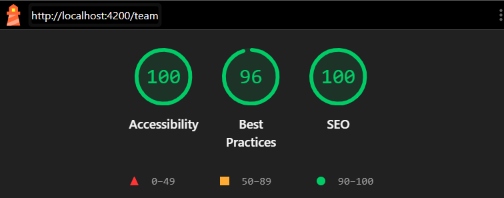

# Task Management Dashboard

A task management dashboard built with **Angular 21**. It provides a simple way to organize tasks, track their progress, manage team members, and view task statistics.

The main focus of this project was building a maintainable Angular application with reusable components, clear separation of responsibilities, and reactive state management.

## Design Reference

[View Figma Design](https://www.figma.com/design/inRRwrw0RP3v5eIXVx6grq/senior---frontend?node-id=0-1&p=f&t=YkfUtvLYAgw1c0Ld-0)

## Live Demo

- **Frontend:** [Task Management Dashboard](https://task-dashboard-ecru-kappa.vercel.app/)
- **Backend API:** [JSON Server API](https://task-dashboard-2sn6.onrender.com/users)

## Tech Stack

| Technology             | Purpose                      |
| ---------------------- | ---------------------------- |
| Angular 21             | Frontend framework           |
| TypeScript             | Application language         |
| PrimeNG                | UI components                |
| Tailwind CSS           | Styling                      |
| Angular Signals        | State management             |
| Angular Reactive Forms | Form handling and validation |
| HttpClient             | API communication            |
| `httpResource`         | Analytics data fetching      |
| Chart.js               | Analytics charts             |
| Angular CDK            | Drag and drop                |
| JSON Server            | Mock REST API                |
| Vitest                 | Unit testing                 |
| ESLint & Prettier      | Code quality and formatting  |
| Husky                  | Git hooks                    |

## Features

- Create, edit, and delete tasks.
- Organize tasks using a Kanban-style board.
- Move tasks between statuses using drag and drop.
- Search and filter tasks.
- Validate task forms with built-in and custom validators.
- Manage dynamic form controls for task tags.
- Confirm before deleting tasks.
- View task statistics through the analytics dashboard.
- Review recent task updates in the activity feed.
- Browse team members.
- Handle loading and error states.
- Responsive layout.

## Screenshots

### Dashboard


### Task Board


### Analytics


### Lighthouse Report

The Lighthouse report shows **100 Accessibility**, **96 Best Practices**, and **100 SEO**.



## Architecture & Design Decisions

I organized the application by feature and separated data access, state management, and UI responsibilities. This helped keep the implementation organized without making the component structure unnecessarily complicated.

### 1. Feature-Based Structure

The application is divided into four main areas:

- **Core:** Application-wide services, models, stores, validators, and HTTP interceptors.
- **Features:** The main application features: tasks, analytics, and team.
- **Layout:** Shared layout components, including the navbar and sidebar.
- **Shared:** Reusable UI components.

This keeps related functionality together and makes it easier to extend individual features without affecting unrelated parts of the application.

### 2. Smart and Presentational Components

I separated page-level logic from components responsible for displaying information and handling UI interactions.

For example, `TasksPage` coordinates task operations through the store, while `TaskCard` and `TaskColumn` focus on displaying task information and handling their respective interactions.

This keeps the page components responsible for coordinating functionality rather than putting all the logic into one component.

### 3. Dependency Injection and Separation of Responsibilities

I used Angular's dependency injection throughout the application to manage dependencies.

Some examples:

- `TasksStore` injects `TaskService` and `UserService` to handle data operations.
- `TaskService` uses `HttpClient` for API communication.
- `TasksPage` injects `TasksStore` to coordinate task-related operations.
- `TaskFormDialogComponent` uses `FormBuilder` to manage the reactive form.

I also kept responsibilities separated: services handle API communication, the store manages application state, and components handle the UI and user interactions.

### 4. State Management with Angular Signals

I used Angular Signals for task-related state management instead of introducing an external state management library.

The `TasksStore` maintains signals for:

- Tasks
- Loading state
- Error state
- Users
- Active filters

It exposes read-only signals and uses `computed()` to derive filtered tasks and task columns.

### 5. Reactive Forms and Validation

The task form uses Angular Reactive Forms and `FormBuilder`.

It supports both creating and editing tasks, with validation handled inside the form.

The implementation includes:

- Required field validation.
- Minimum title length validation.
- A custom due-date validator to prevent selecting past dates when creating tasks.
- Required assignee validation.
- Dynamic tags managed through `FormArray`.
- Existing task data being populated when editing.

Using reactive forms keeps the form state and validation logic organized and makes it easier to manage dynamic controls.

### 6. Services and API Communication

I separated API communication into dedicated services:

- `TaskService` handles task CRUD operations.
- `UserService` retrieves team member data.
- `TasksStore` coordinates these services and manages the related application state.

For HTTP requests, I implemented:

- Retry handling for failed requests.
- Error handling with user-friendly messages.
- A caching interceptor for GET requests.
- Cache invalidation after non-GET requests.

I also used Angular's `httpResource` to retrieve analytics statistics.

### 7. Routing and Lazy Loading

The application uses Angular routing to organize its pages.

The Analytics and Team features use `loadComponent` for lazy loading, so their components are loaded when their routes are accessed rather than being included in the initial page load.

### 8. Performance Considerations

A few techniques were used to keep the application responsive and avoid unnecessary work:

- `OnPush` change detection where applicable.
- Angular Signals for reactive state updates.
- Lazy loading for feature routes.
- HTTP caching for GET requests.
- Cache invalidation after data mutations.
- Track functions for efficient list rendering.
- RxJS operators such as `finalize`, `retry`, and `catchError` for request handling.

## Project Structure

```text
src/
├── app/
│   ├── core/
│   │   ├── interceptors/
│   │   ├── models/
│   │   ├── services/
│   │   ├── stores/
│   │   └── validators/
│   │
│   ├── features/
│   │   ├── analytics/
│   │   │   └── activity-feed/
│   │   ├── tasks/
│   │   │   ├── statistic-card/
│   │   │   ├── task-card/
│   │   │   ├── task-column/
│   │   │   └── task-form-dialog/
│   │   └── team/
│   │
│   ├── layout/
│   │   ├── navbar/
│   │   └── sidebar/
│   │
│   └── shared/
│
├── index.html
├── main.ts
└── styles.css

docs/
├── demo (1).png
├── demo (2).png
├── demo (3).png
└── lighthouse.png

public/
└── favicon.ico
```

## Getting Started

### Prerequisites

Make sure you have the following installed:

- Node.js
- npm
- Angular CLI

### Installation

Clone the repository:

```bash
git clone https://github.com/HabibaMar3i/task-dashboard
```

Navigate to the project directory:

```bash
cd task-dashboard
```

Install dependencies:

```bash
npm install
```

### Running Locally

The project uses JSON Server as a mock API.

Start the Angular application and mock API together:

```bash
npm run dev
```

This command starts both servers concurrently.

You can also run them separately:

```bash
npm run mock:api
```

```bash
npm start
```

The application will be available at:

- **Angular:** `http://localhost:4200`
- **JSON Server:** `http://localhost:3000`

If you need to regenerate the mock data, run:

```bash
npm run mock:seed
```

## Environment Configuration

The application uses different API routing configurations for local development and production deployment.

### Local Development

The Angular development server uses `proxy.conf.json` to forward requests starting with `/api` to the local JSON Server.

The frontend uses relative API paths, such as:

```text
/api/tasks
/api/users
```

This allows the application to communicate with the mock API without hardcoding the local backend URL in the services.

The development server is started with:

```bash
ng serve --proxy-config proxy.conf.json
```

### Production

In production, the frontend is deployed to Vercel and the JSON Server backend is hosted separately on Render.

A Vercel rewrite in `vercel.json` forwards `/api` requests to the Render backend:

```json
{
  "rewrites": [
    {
      "source": "/api/(.*)",
      "destination": "https://task-dashboard-2sn6.onrender.com/$1"
    }
  ]
}
```

This keeps the same `/api` paths in the Angular services across development and production.

## Available Scripts

| Command                 | Description                                 |
| ----------------------- | ------------------------------------------- |
| `npm start`             | Starts the Angular development server       |
| `npm run build`         | Builds the application                      |
| `npm run test`          | Runs unit tests                             |
| `npm run test:coverage` | Runs tests and generates a coverage report  |
| `npm run lint`          | Runs ESLint                                 |
| `npm run lint:fix`      | Fixes linting issues where possible         |
| `npm run format`        | Formats source files with Prettier          |
| `npm run mock:seed`     | Generates mock data and builds the database |
| `npm run mock:api`      | Starts JSON Server                          |
| `npm run dev`           | Starts Angular and JSON Server together     |

## Testing & Code Coverage

I used **Vitest** for unit testing. GitHub Copilot assisted with generating test cases, which I reviewed and integrated into the project.

The current V8 coverage report shows **84.16% statement coverage**, exceeding the assignment's minimum requirement of 80%.

### Coverage Results

| Metric     | Coverage |
| ---------- | -------: |
| Statements |   84.16% |
| Branches   |   89.61% |
| Functions  |   72.88% |
| Lines      |   89.90% |

Several areas, including the application entry point, stores, team feature, and layout components, achieved 100% coverage.

Some task-related components and page logic still have uncovered paths, so there is room to improve the coverage further.

To run the tests and generate the coverage report:

```bash
npm run test:coverage
```

## Deployment

The application is deployed using Vercel for the frontend and Render for the mock API.

### Frontend – Vercel

The Angular application is deployed on Vercel:

[https://task-dashboard-ecru-kappa.vercel.app/](https://task-dashboard-ecru-kappa.vercel.app/)

To create a production build:

```bash
npm run build
```

### Backend – Render

JSON Server is hosted separately on Render:

[https://task-dashboard-2sn6.onrender.com/users](https://task-dashboard-2sn6.onrender.com/users)

The frontend communicates with the backend through the Vercel rewrite configuration described in the Environment Configuration section.

## Known Limitations

- The backend uses JSON Server with mock data rather than a production database and backend.
- The mock API is intended for demonstration and testing, not production use.
- The Render free service may sleep after periods of inactivity, which can cause delays on the first request.
- Some task-related component interactions and logic still have uncovered test paths.

## Future Improvements

- Replace JSON Server with a production-ready backend and persistent database.
- Increase test coverage for remaining task-related logic and component interactions.
- Improve accessibility and keyboard navigation.
- Expand error handling and user feedback.
- Further optimize the production build.

## AI-Assisted Development

I used AI tools as assistants for specific implementation and testing tasks, while I was responsible for the overall application architecture, folder structure, component organization, and technical decisions.

- **Claude Chat:** I provided existing implementation references and described the expected behavior to get assistance with implementing the store logic. This helped reproduce and adapt the required logic consistently within the project. I used Claude Chat as an assistant, not an autonomous coding agent.
- **GitHub Copilot:** I used Copilot to assist with generating unit test cases and resolving a bundling-related issue in `angular.json`.

I reviewed and integrated the generated code into the project.

---

**Developed as part of a Senior Frontend Engineer technical assignment.**
